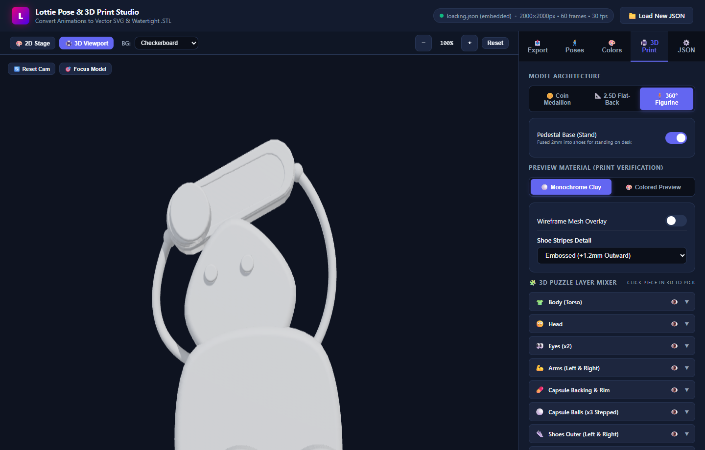
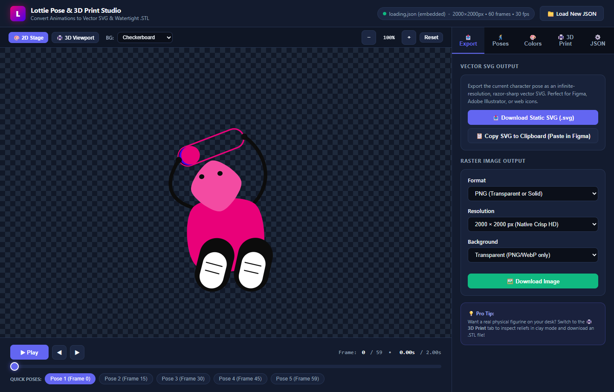
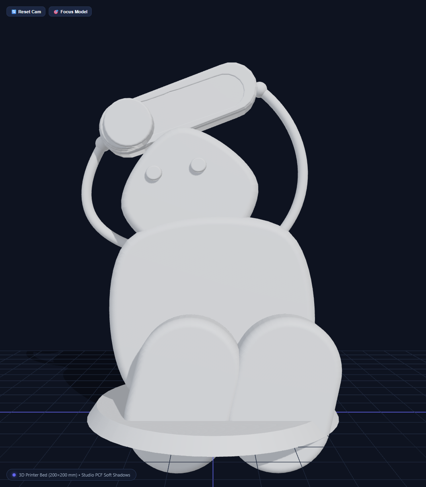
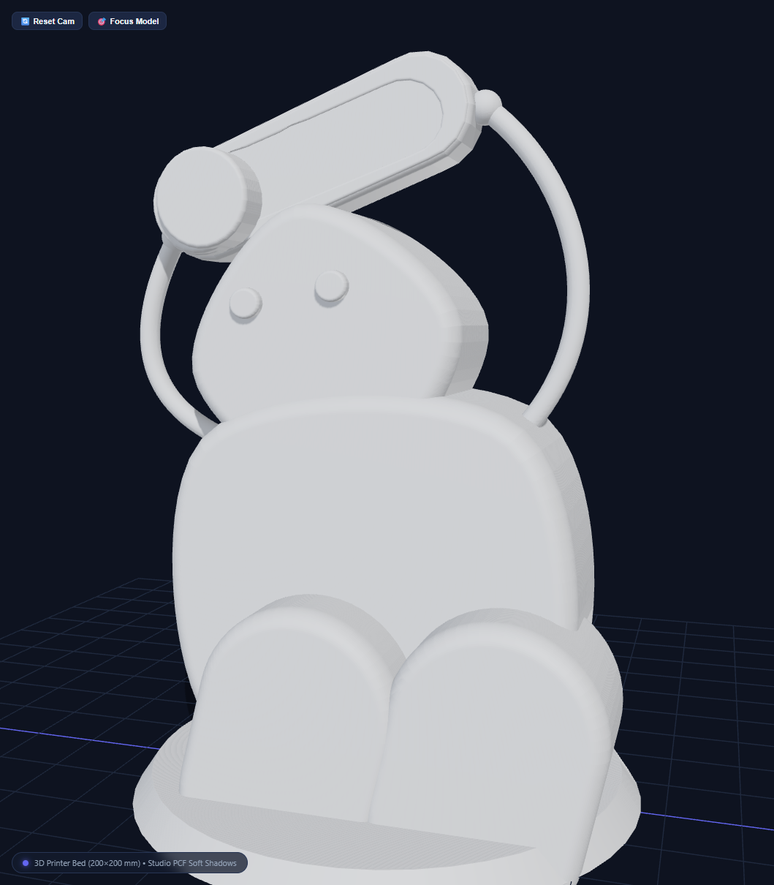
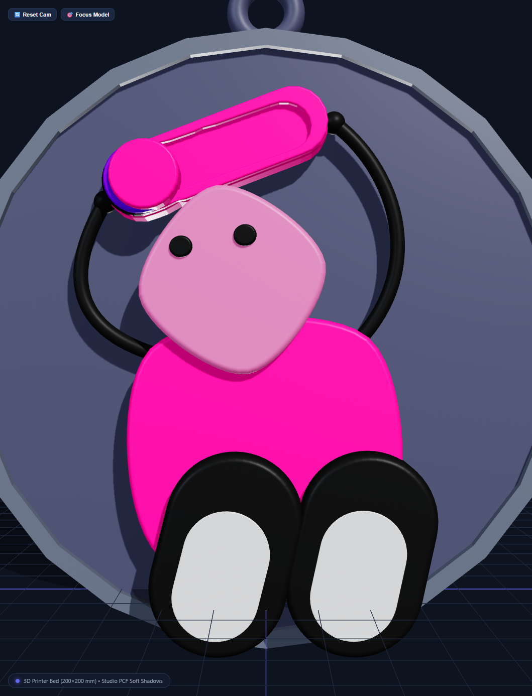
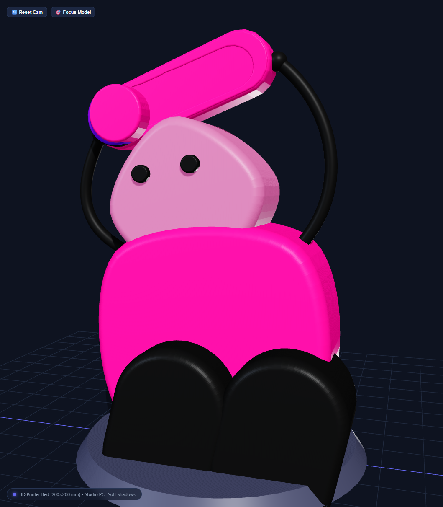
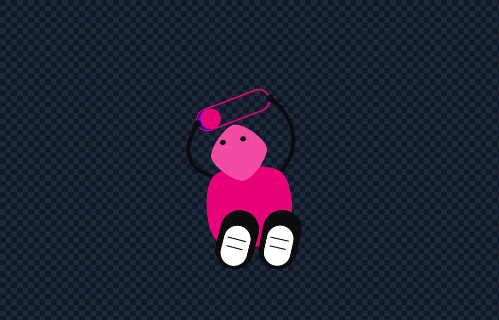
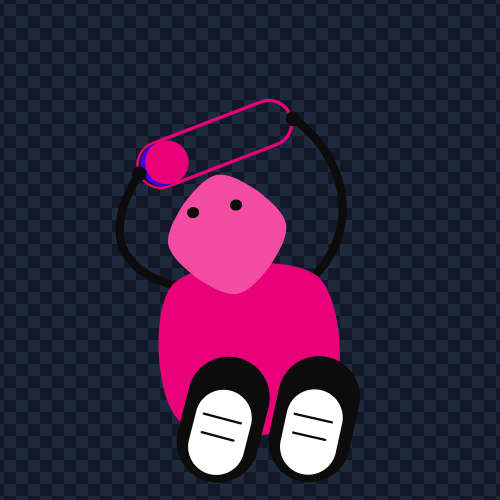

# Lottie Pose & 3D Print Studio

An interactive, zero-dependency local web studio for extracting static poses from Lottie animations, customizing limb angles and colors, inspecting watertight geometry in 3D, and exporting **Vector SVG**, high-resolution **PNG/JPEG/WebP**, or 3D-printable **Binary .STL** files.

---

## 📸 Output Showcase & Sample Demos

### 1. Web Panel Demo Interface
Interactive web studio with real-time 2D pose manipulation and 3D print verification.

| 🖨️ 3D Print Studio & Puzzle Layer Mixer | 🎨 2D Pose & Timeline Editor |
| :---: | :---: |
|  |  |
| *Real-time Three.js viewport, live slicer metrics, and 10-layer puzzle mixer* | *60-frame timeline scrubber, limb rotation sliders, and palette themes* |

---

### 2. 🖨️ 3D Print STL Output Samples
Watertight binary `.STL` models designed for single-color FDM/SLA/Resin 3D printing with zero co-planar merging.

| ⚪ Monochrome Clay (Front View) | 🧍 360° Figurine + Pedestal Stand |
| :---: | :---: |
|  |  |
| *Verified single-color crevice visibility and stepped reliefs* | *Puffy double-sided volumetric figurine fused to a circular desk stand* |

| 🪙 Coin / Medallion Mode (With Keychain Loop) | 🎨 3D Colored Palette Preview |
| :---: | :---: |
|  |  |
| *Solid backing disc with raised rim and lanyard keyring loop* | *Custom theme preview showing multi-material and color mapping* |

📥 **Sample STL File:** [`docs/sample_character_watertight.stl`](docs/sample_character_watertight.stl) *(2.5 MB Binary STL, Z-Up oriented for Cura / Bambu Studio / PrusaSlicer)*

---

### 3. 🎨 Static Vector SVG & High-Resolution PNG Output Samples

| 📐 Scalable Vector Graphic (SVG) | 🖼️ High-Resolution PNG Render |
| :---: | :---: |
|  |  |
| *Clean SVG vector paths with baked transforms for Figma / Illustrator* | *High-DPI rasterized character with transparent/checkerboard background* |

- 📥 **Sample SVG File:** [`docs/sample_character.svg`](docs/sample_character.svg)
- 📥 **Sample PNG File:** [`docs/sample_character.png`](docs/sample_character.png)

---

## 📥 Installation & Getting Started

### 1. Clone or Download the Repository

#### Option A: Via Git (Recommended)
```bash
git clone https://github.com/miladshakerdn/vector-to-3d-print.git
cd vector-to-3d-print
```

#### Option B: Direct ZIP Download
1. Click the green **Code** button at the top of the GitHub repository.
2. Select **Download ZIP**.
3. Extract the ZIP file to any folder on your computer.

---

### 2. How to Launch the Application

You can run the application in three ways depending on your environment:

#### 🟢 Method 1: Zero-Install Instant Launch (100% Offline, No Node or Python Required!)
- **Action:** Simply double-click [`index.html`](index.html) in your file explorer.
- **Why it works:** All required libraries (`three.min.js`, `OrbitControls.js`, `SVGLoader.js`, `BufferGeometryUtils.js`, `STLExporter.js`, and `lottie.min.js`) are pre-bundled locally in the folder. Fallback character animation data is embedded in [`embedded-data.js`](embedded-data.js), allowing the studio to function completely offline without an internet connection or web server.

#### 🟢 Method 2: One-Click Windows Launcher (`start.bat`)
- **Action:** Double-click [`start.bat`](start.bat).
- It will automatically launch a lightweight local server on port **8585** and open `http://localhost:8585` in your default browser.
> [!NOTE]  
> Port **8080** is deliberately bypassed to avoid conflicts with system Docker or WSL processes. Port **8585** is the dedicated local port.

#### 🟢 Method 3: Cross-Platform Terminal / CLI Launchers
If you prefer running via command line on Windows, macOS, or Linux:

**Using Python 3:**
```bash
python -m http.server 8585
# Then navigate to: http://localhost:8585
```

**Using Node.js (npx):**
```bash
npx serve -l 8585
# Or using http-server:
npx http-server -p 8585
```

**Using PHP:**
```bash
php -S localhost:8585
```

---

### 3. Optional: Developer Verification & Test Suite
If you want to run the automated headless Chromium verification scripts (`verify-all.js`):

**Prerequisites:**
- [Node.js](https://nodejs.org/) (version 16 or newer)
- Microsoft Edge or Google Chrome installed

**Setup & Execution:**
```bash
# 1. Install optional dev dependencies (puppeteer-core)
npm install

# 2. Run the visual verification suite
node verify-all.js
```
The script will launch a headless browser, test all 2D and 3D viewports, inspect mesh watertightness, and capture verification screenshots in [`docs/`](docs/).

---

---

## 🖨️ 3D Print Studio Features

The **3D Print Studio** tab inspects the character pose in real-time 3D and exports a watertight, single-color printable `.STL` file.

### 1. Interactive 3D Viewport & Single-Color Print Inspection
* **Three.js + OrbitControls**: Rotate, pan, and zoom around the character in real-time 3D space.
* **Studio Three-Point Lighting with Soft Shadows**: Key, fill, and rim lights with real-time shadow casting (`PCFSoftShadowMap`) to highlight all physical creases, bevels, and surface reliefs.
* **3D Printer Build Plate**: A standard printer grid with shadow-receiving ground plane.
* **View Modes**:
  * **Monochrome Clay / Print Preview (Default)**: Renders all meshes in unified matte gray clay/resin (`color: 0xd0d4dc, roughness: 0.65, metalness: 0.05`). Verifies that every feature (chin crease, eye domes, shoe stripes, overlapping balls) is visible through geometry and shadows alone without relying on 2D color.
  * **Colored Preview**: Displays meshes with your active palette colors.
  * **Wireframe Overlay**: Inspects triangle distribution and clean manifold topology.

### 2. Triple Geometry Architecture
* **🪙 Coin / Medallion Mode**:
  * Places a solid circular or rounded-capsule medallion disc behind the character with an embossed outer rim.
  * Includes an optional **Keychain Hole Loop** at the top for lanyards, keyrings, or bag tags.
  * Zero supports required — prints flat on the print bed.
* **📐 2.5D Flat-Back / Relief Mode**:
  * Aligns the back of the torso, head, shoes, arms, and capsule to a flat $Z = 0$ plane. Prints directly on the build bed with **zero supports required**.
* **🧍 360° Full Figurine Mode (with Pedestal Stand)**:
  * Double-sided volumetric geometry across the Z-axis with curved front and back bevels.
  * Includes a sturdy circular **Pedestal Base (Stand)** ($68\text{ mm}$ diameter, $4\text{ mm}$ height) that physically intersects the bottom of the shoes by $1.8\text{ mm}$ for stable, non-tipping display. (Toggle On/Off).

### 3. Interactive "3D Puzzle Layer Mixer"
* **10 Semantic Puzzle Layers**:
  1. `Base / Coin Plate` (for Coin Mode)
  2. `Body (Torso)`
  3. `Head`
  4. `Eyes (x2)`
  5. `Arms (Left & Right)`
  6. `Top Capsule Backing & Rim`
  7. `Capsule Balls (x3 Stepped Heights)`
  8. `Shoes Outer (Left & Right)`
  9. `Shoe Inner Soles`
  10. `Shoe Stripes (x4)`
* **Click-to-Pick (Raycasting)**: Click any piece directly in the 3D viewport to automatically highlight, expand, and focus its controls in the sidebar.
* **Live Controls Per Piece**:
  * **Z-Offset (mm)**: Fine-tune forward/backward stacking and interlocking penetration.
  * **Thickness / Depth (mm)**: Adjust extrusion height.
  * **Bevel / Roundness (mm)**: Control edge fillet and smoothing.
  * **Scale / Boost**: Boost line/tube thickness for arms and stripes.
  * **Visibility Eye Toggle**: Show or hide individual parts.

### 4. Stepped Z-Relief for Single-Color Visibility
* **Body & Head**: Head is positioned forward in Z relative to the body (penetrating deep inside the upper chest) so the V-shaped chin crease casts a distinct shadow on the torso.
* **Eyes**: Raised 3D dome spheres protruding $+1.8\text{ mm}$ outward from the front surface of the head.
* **Shoes & Stripes**:
  * Outer shoe body sitting in front of the lower torso.
  * Inner white shoe oval physically embossed $+1.5\text{ mm}$ outward above the shoe surface.
  * 2 Stripes on each shoe with UI toggle for **Embossed (+1.2mm)** vs **Engraved (-1.2mm)** recessed grooves.
* **Top Loading Capsule**:
  * Built as a solid 2.5D rounded-rectangle backing plate ($4\text{ mm}$ thick) with a raised outer rim ($+2\text{ mm}$).
  * **Stepped Overlapping Balls**: Left circle ($+1.5\text{ mm}$), Middle circle ($+3.0\text{ mm}$), and Right circle ($+4.5\text{ mm}$) with rounded bevels, creating sharp physical crescent shadows where they overlap.
* **Arms**: Converted from stroked bezier paths into solid 3D cylindrical tubes (`TubeGeometry` with spherical end-caps). The ends penetrate deep into the torso and top capsule frame.

### 5. Real-World Sizing & Binary STL Export
* **Sliders**: Target Print Height ($50\text{ mm} - 250\text{ mm}$, default $100\text{ mm}$), Body Depth/Puffiness ($50\% - 200\%$), Arm Tube Thickness ($2.5\text{ mm} - 8.0\text{ mm}$), and Detail Relief Depth ($0.8\text{ mm} - 3.0\text{ mm}$).
* **Live Slicer Metrics Card**: Displays live Height, Width, Depth (in millimeters), Triangle count ($51,720$ triangles), and manifold verification.
* **Binary STL Download**: Merges visible meshes, scales to real-world millimeters, orients upright with **$Z$-Up** (universal slicer standard for Cura, Bambu Studio, PrusaSlicer, OrcaSlicer), and exports a binary `.stl` file.

---

## 🎨 2D Pose & Vector Studio Features

* **Frame Timeline Scrubber**: Scrub through 60 frames (0.00s to 2.00s) to capture any dynamic pose.
* **Limb Articulation**: Sliders for Left/Right Hand rotation, Left/Right Shoe rotation, Head Tilt, Eye Gaze offsets, and part toggles.
* **Color Palette Editor**: Instant preset themes (Original, Cyberpunk Neon, Emerald Mint, Sunset Amber, Dark Slate, Royal Violet) and custom hex pickers.
* **SVG & Raster Export**: Download static vector `.svg`, copy SVG code directly to clipboard for Figma/Illustrator, export high-res PNG/WebP/JPEG (up to $4000\times4000$ 4K), or save modified Lottie JSON.
